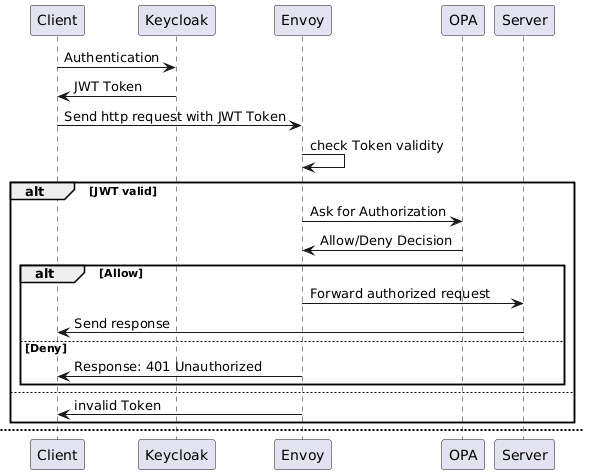

# General Access Control with [Envoy](https://github.com/envoyproxy/envoy) and [OPA (Open policy Agent)](https://github.com/open-policy-agent/OPA)

This example shows how to put access control in front of any HTTP application without adding authorization code to the application itself.

## Overview
This example uses:
1. **Keycloak** for user authentication.
2. **Envoy reverse proxy** to act as an intermediary, enforcing authentication and authorization. It validates JWTs and calls OPA for authorization.
3. **Open Policy Agent (OPA)** for access control.
4. **app**: A replaceable demo application. In real deployments this is the service you want to protect.

The application only receives requests after:

1. Envoy has verified the incoming bearer token against an OpenID Connect issuer.
2. Envoy has asked OPA whether the verified request is allowed.
3. OPA has matched the request method, path and token roles against the configured policy data.



## Run

```bash
docker compose up
```

The demo Keycloak realm `access-control-demo` (client `access-control-demo-client`, secret `change-me`) is imported
automatically with these users:

| User | Password | Role |
|------|----------|------|
| `reader` | `reader` | `reader` |
| `writer` | `writer` | `writer` |
| `admin` | `admin` | `admin` |

Envoy listens on http://localhost:10000, its admin interface on http://localhost:8001 (only from this machine). OPA
has no published ports. Envoy normalizes request paths before asking OPA, and the policy additionally denies paths that
are not canonical (`..`, `//`, encoded `.`, `/`, `\` or `%`).

Policy unit tests (no running stack needed):

```bash
docker run --rm -v "$PWD/../..:/ac:ro" openpolicyagent/opa:1.21.2-envoy-static test /ac/policy /ac/examples/general/policy_data -v
```

## Adapting It to Any Application

All settings are in [`.env`](.env); `envoy.yaml.tmpl` and `keycloak/realm.json` take their values from there.

1. Point `APP_HOST` and `APP_PORT` to your application (and remove the `app` placeholder service from `compose.yaml`).
2. Set the OpenID Connect values for your identity provider: `OIDC_ISSUER`, `OIDC_CLIENT_ID` (the expected audience)
   and `OIDC_JWKS_HOST`, `OIDC_JWKS_PORT`, `OIDC_JWKS_PATH` (where Envoy fetches the signing keys). If you use your
   own identity provider, the `keycloak` service and `keycloak/realm.json` are not needed.
3. Set `ROLE_CLAIM` if your tokens carry the roles somewhere other than `realm_access.roles`.
4. Edit `policy_data/data.json` to describe the application's public paths, protected path prefixes, methods and
   required roles.

The Rego policy in [`access_control/policy/policy.rego`](../../policy/policy.rego) is shared by all examples and
intentionally generic. Application-specific changes belong in `policy_data/data.json`.
